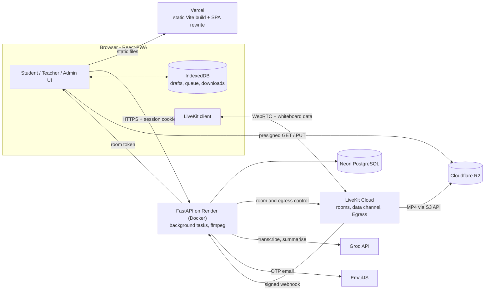

# LanternEd

**An offline-first, low-bandwidth learning platform for any institution where connectivity is unreliable — rural or urban, any country: live classes that adapt to weak connections, recorded lessons, AI-assisted study notes, downloadable materials, and assignments that can be written and submitted without a connection.**

LanternEd gives a college everything it needs to teach students who have unreliable, expensive or slow internet and few devices: teachers run live classes (with a floating video window, a shared whiteboard, screen sharing and a blurred background), record them, and publish lessons with transcripts and AI summaries they approve; students join live, catch up from recordings, download material for offline study and submit work even when the network drops. Colleges, branches and sections are set up by an administrator, and registration is tied to a college code.

* **Live app:** frontend <https://edu-village-nine.vercel.app> · backend API <https://eduvillage-api.onrender.com> (`/health`, `/docs`)
* **Documentation:** [Admin panel](docs/ADMIN_PANEL.md) · [Classroom and course tools](docs/CLASSROOM_AND_COURSE_TOOLS.md) · [API reference](docs/API_CONTRACTS.md) · [Database schema](docs/DATABASE_SCHEMA.md) · [Backend setup](docs/BACKEND_SETUP.md) · [Backend overview](docs/BACKEND_AUDIT.md) · [Requirements matrix](docs/BACKEND_REQUIREMENTS_MATRIX.md) · [Verification status](docs/FINAL_AUDIT.md) · [Recording pipeline](docs/RECORDING_VERIFICATION.md) · [Multi-college support](docs/MULTI_INSTITUTION_AUDIT.md) · [Codebase structure](docs/DEDUPLICATION_REPORT.md) · [Scalability architecture](docs/SCALABILITY_ARCHITECTURE.md) · [Infrastructure cost model](docs/INFRASTRUCTURE_COST_MODEL.md) · [Upgrade roadmap](docs/DEPLOYMENT_UPGRADE_ROADMAP.md) · [Evaluation answers](docs/SCALABILITY_EVALUATION_ANSWERS.md) · [Capacity test plan](docs/CAPACITY_TEST_PLAN.md) · [Self-hosting](docs/SELF_HOSTING.md) · [Frontend guide](frontend/README.md)

## Table of contents

1. [Walkthrough](#1-walkthrough)
2. [Problem and solution](#2-problem-and-solution)
3. [Features](#3-features)
4. [Roles and permissions](#4-roles-and-permissions)
5. [Technology stack](#5-technology-stack)
6. [System architecture](#6-system-architecture)
7. [Application workflows](#7-application-workflows)
8. [Deployment](#8-deployment)
9. [Local development](#9-local-development)
10. [Environment variables](#10-environment-variables)
11. [Security](#11-security)
12. [Free-tier infrastructure](#12-free-tier-infrastructure)
13. [Scalability and cost](#13-scalability-and-cost)
14. [Testing](#14-testing)
15. [Project structure](#15-project-structure)
16. [Development workflow](#16-development-workflow)
17. [Operations](#17-operations)
18. [Roadmap](#18-roadmap)
19. [References](#19-references)

---

## 1. Walkthrough

A step-by-step tour of the product, in the order a college would use it. (Self-registration needs an administrator-issued college code, so the quickest way to click through everything yourself is the [local setup](#9-local-development): `alembic upgrade head` then `python -m app.seed` creates a college, branch, section and demo teacher and student.)

1. **The administrator sets up the institution.** Sign in at `/platform-console`, create a college (a name is all that is needed) and a unique code like `EV-XXXX-XXXX` is generated; add branches (for example "Computer Science") and sections ("Section A", "Section B").
2. **A teacher registers** at `/register/teacher`: choose college, branch and a section or **All Sections** (a branch-wide assignment), enter the college code, and you are signed in.
3. **A student registers** at `/register/student` the same way. Registering does not enrol anyone in a course.
4. **The teacher creates a course**, publishes it, and can **import the curriculum** by pasting lessons or uploading a text syllabus PDF, reviewing the proposed lessons before adding them. The teacher sees a live **roster** of enrolled students.
5. **The student enrols:** Course Catalogue, then **Enroll**, which becomes **View Course**.
6. **The teacher schedules and starts a live class**, optionally for one section or, for an All Sections teacher, the whole branch (students of the branch see it under **Other Classes**).
7. **Students join the same LiveKit room.** Each gets a token only if authorised for that class's audience; students receive audio and video and cannot publish. On a weak connection the app drops to audio-only and restores video when the link recovers.
8. **Inside the class** the teacher's camera is a small floating window for everyone (drag, enlarge, hide) with the background blurred; the teacher can open a **whiteboard** (pen, text, eraser, colours, undo) that every student sees live and can save as an image, and can **share one or several screens**.
9. **The teacher records and ends the class.** The recording goes to Cloudflare R2 and stays private until published.
10. **An AI summary appears automatically:** the recording is transcribed (Whisper) and summarised (LLM); the teacher reviews and approves it; students read it on the Recorded Lessons page and download the notes as **PDF or Word**.
11. **Offline study.** Students download recordings and resources (a **Save to Device** option writes a real file) and write assignment answers offline; drafts sync automatically, exactly once, when the device is online again. Students can also attach **PDF, DOC or DOCX** files to a submission.
12. **Password recovery.** A 6-digit code is emailed (5 minutes, 5 attempts, resend cooldown), then a single-use authorisation lets the user set a new password; every other session is revoked.
13. **Second-device protection.** Signing in on a new device while the account is signed in elsewhere requires an emailed code to approve it; once approved the older session ends.
14. **Administrator protection.** The administrator account has one active session at a time and an idle timeout, and nobody can self-register with the administrator's email.
15. **Course lifecycle.** A teacher can **Archive** a course (hidden from the catalogue, nothing deleted), **Restore** it, or **Permanently Delete** an archived course.
16. **Institution delegation.** The administrator can hand day-to-day branch/section management of one college to a trusted teacher, who then manages it at `/teacher/institution` without needing the administrator for routine changes.
17. **Language.** Anyone can switch the interface language at any time from the switcher on the sign-in, registration and navigation screens; the choice is remembered on that device and never requires a network request.

---

## 2. Problem and solution

| Challenge in connectivity-constrained institutions | What LanternEd provides |
|---|---|
| Weak or expensive internet | Adaptive audio-only mode in live classes; offline-first assignment drafts and sync; resumable downloads of recordings and materials; a whiteboard that works over a few hundred bytes per stroke |
| Few devices, shared computers | Shared-device mode clears drafts, queue and downloads on sign-out; revocable server sessions |
| Limited teaching staff | One recording or resource can be shared with many sections without copying; one branch-wide class reaches every student of a branch |
| Hard to attend live classes | Recorded lessons, transcripts, teacher-reviewed AI summaries, study notes as Word, flashcards generated from the summary, and read-aloud for the text fallback |
| Hard to submit work | Offline drafts, idempotent retrying sync, optional PDF/DOC/DOCX attachments, deadlines with an offline grace period |
| Many colleges on one platform | Administrator-managed colleges, branches and sections; college codes; branch-level isolation of classes and recordings |

## 3. Features

| Area | What it does |
|---|---|
| Accounts | Student and teacher registration against a college, its code, branch and section; email and password with argon2 hashing; server-side sessions; session list and revocation; shared-device mode |
| Sign-in protection | Second-device sign-in needs an emailed one-time code and ends the older session; password recovery by emailed code |
| Administrator panel | `/platform-console`: colleges with unique generated codes (regenerate, activate or deactivate), branches and sections per college, overview counts; separate cookie, CSRF header, rate limit, one active session with idle timeout |
| Institution delegation | The administrator can delegate a teacher to manage one college's branches and sections at `/teacher/institution`, without granting access to college creation, activation or other colleges; revocable at any time |
| Internationalisation | 21 bundled languages (not fetched over the network, so switching costs nothing on a slow connection): English, Mandarin Chinese, Hindi, Arabic, Bengali, Portuguese, Russian, Urdu, Indonesian, Swahili, Japanese, and ten further Indian languages (Telugu, Marathi, Tamil, Gujarati, Kannada, Odia, Malayalam, Punjabi, Assamese, Maithili); a language switcher on every auth and navigation surface |
| Courses | Create, publish, archive, restore, permanently delete; catalogue with an Enroll button that becomes View Course; teacher roster; co-teachers; lessons; curriculum import (paste or syllabus PDF) |
| Cohorts and scope | Course sections with membership; teachers assigned to one college section or to All Sections of a branch, which limits which cohorts they can address |
| Live classes | Schedule, start, end, join with room-scoped tokens (students subscribe only); branch-wide classes with an Other Classes area; adaptive audio-only mode; connection recovery with offline fallbacks |
| Live classroom tools | Floating teacher video, teacher background blur, shared whiteboard (type or draw, late joiners get the full board, students can save it), one or several shared screens |
| Recorded lessons | Explicit teacher recording (room composite to R2), signed webhook, finalisation check, publish, signed playback, library, progress, per-section sharing |
| Learning resources | Teacher uploads with content validation, publication, per-section sharing, offline download |
| Assignments | Create, draft, submit, revise, deadlines; offline drafts with idempotent sync; PDF, DOC and DOCX attachments (5 files, 20 MB each) viewable and downloadable by the teacher |
| AI study aids | Chunked Whisper transcription, LLM summaries with teacher review, notes download as PDF or Word |
| Dashboards | Student dashboard (courses, classes, recordings, assignments, teachers of the student's own section or branch); teacher dashboard |
| Offline and PWA | Installable app, precached shell, IndexedDB drafts, queue and downloads, resumable ranged downloads, real storage meter |
| Audit | Append-only audit events for security-relevant actions |

## 4. Roles and permissions

| Role | Can | Cannot |
|---|---|---|
| Student | Browse the catalogue, enrol, join classes they are authorised for (section or branch audience), watch published recordings, submit assignments with files, use offline features | Create courses or classes; see another branch's branch-wide classes; use any admin endpoint |
| Teacher | Create courses, cohorts, classes, resources and assignments; record; review summaries; import curricula; address the cohorts within their assigned section or branch | Teach outside their assignment's scope; register as administrator; use admin endpoints |
| Administrator | Manage colleges, codes, branches and sections at `/platform-console`; delegate teachers as institution administrators | Use the student and teacher API (and vice versa) |

Authorisation is decided in backend services from the server-side session; a client-supplied role, college, branch or section is always validated. College codes identify a college for registration and grant no privilege. A small number of teachers may additionally be delegated by the administrator as an **institution administrator** for one college — they gain access to that college's own branches and sections at `/teacher/institution`, but college creation and activation stay administrator-only, and the delegation is revocable at any time.

## 5. Technology stack

| Layer | Technology |
|---|---|
| Frontend | React 19, TypeScript, Vite 8, Tailwind CSS v4, React Router 7, TanStack Query, React Hook Form and Zod, Dexie (IndexedDB), `vite-plugin-pwa` / Workbox, LiveKit client and components, `@livekit/track-processors`, `jspdf`, `docx`, `i18next` / `react-i18next` / `i18next-browser-languagedetector` (21 bundled locales) |
| Backend | Python 3.12, FastAPI, Pydantic v2, SQLAlchemy 2, Alembic, uvicorn, argon2-cffi, boto3, httpx, `openai` SDK (OpenAI-compatible APIs), `livekit-api`, `pypdf`, ffmpeg |
| Database | PostgreSQL 18 on Neon (production); SQLite for development; PostgreSQL also used for tests |
| Live classes | LiveKit Cloud (tokens, rooms, data channel, Egress, signed webhooks) |
| Email and OTP | EmailJS REST API, called from the backend (separate templates for password reset and new-device approval) |
| AI | OpenAI-compatible provider selected by configuration: Groq `openai/gpt-oss-120b` and `whisper-large-v3-turbo` in `render.yaml`; a labelled stub when unconfigured |
| Storage | Cloudflare R2 (S3 API); local disk in development |
| Hosting | Vercel (frontend), Render (backend Docker service), Neon, LiveKit Cloud, Cloudflare R2 |
| Source control | GitHub (`yynvr1408/LanternEd`) |
| Testing | pytest, Vitest with Testing Library, Playwright |
| Tooling | oxlint, strict TypeScript build, Docker Compose for local PostgreSQL |

## 6. System architecture



* **Frontend to backend:** the SPA calls the API directly (`VITE_API_BASE_URL`) through one module, `frontend/src/services/apiClient.ts` (the administrator panel uses `adminApi.ts`). Sign-in is an httpOnly cookie (`SameSite=None; Secure` between Vercel and Render); the API allows one CORS origin.
* **Database:** SQLAlchemy sessions per request; Alembic migrations run when the container starts.
* **Live media:** the backend authorises and issues short-lived room tokens; media flows between browsers and LiveKit. Recording is LiveKit Egress straight into R2, finalised by a signed webhook plus an object check. The whiteboard travels over the LiveKit data channel.
* **Files:** recordings and uploads (including assignment attachments) go straight between the browser and R2 with presigned URLs; the API never carries the bytes.
* **AI and email:** a background task transcribes recordings and asks the LLM for a summary; the backend generates and verifies OTPs and calls EmailJS server-side, so a code never reaches the browser in production.

## 7. Application workflows

| Workflow | Steps |
|---|---|
| Institution setup | `/platform-console` sign-in, create college (code generated), add branches and sections, activate |
| Registration | Student or Teacher portal, college, branch, section (teachers may choose All Sections), college code, account and session |
| Sign-in | Password, then session; on an already signed-in account an emailed code approves the new device and ends the older session |
| Password recovery | Email, code emailed, verify, new password, sign in again |
| Course discovery and enrolment | Catalogue, **Enroll**, then **View Course** |
| Teaching | Create course, cohorts and classes (branch-wide teachers can target "All sections in <branch>"), start, students join, end, optional recording, publish |
| Live class tools | Floating video, whiteboard, one or several screens, blurred background |
| Other Classes | Branch-wide classes appear for enrolled students of that branch in their own section |
| Assignments | Student drafts offline, queued, synced idempotently; optional PDF, DOC, DOCX attachments; teacher reads answers and downloads files |
| AI study notes | Recording, transcript, summary, teacher review, student reads and downloads PDF or Word |
| Course curriculum | Paste lessons or upload a text PDF, review, add |
| Course lifecycle | Archive, restore, or permanently delete from the archive |

## 8. Deployment

* **Frontend: Vercel.** A static Vite build; `frontend/vercel.json` rewrites every path to `index.html` so `/platform-console` and other routes survive a refresh. There are no serverless or edge functions. `VITE_API_BASE_URL` is set in the Vercel project (build-time, public).
* **Backend: Render**, a Docker web service defined in `render.yaml` (health check `/health`, secrets set in the dashboard). The container runs `alembic upgrade head` and then `uvicorn`.
* **Database: Neon** PostgreSQL (`DATABASE_URL`, `sslmode=require`).
* **LiveKit Cloud**, **Cloudflare R2**, **Groq** and **EmailJS** are reached from the backend and, for media and presigned URLs, from the browser.
* **CORS and cookies:** `FRONTEND_ORIGIN` is the single allowed origin and `SESSION_COOKIE_SAMESITE=none` carries the cross-site cookie between Vercel and Render.

| Component | Status |
|---|---|
| Vercel frontend | deployed, SPA rewrite in `vercel.json` |
| Render backend | deployed as a Docker service from `render.yaml` |
| Neon | PostgreSQL 18, 33 tables, linear migration chain |
| LiveKit Cloud | real-room test with several students passes |
| EmailJS | OTP emails through the EmailJS REST API |
| Groq | transcription and summaries configured in `render.yaml` |
| R2 | recordings and uploads through the S3 API |

**Self-hosting.** The centrally-hosted deployment above is the default, but institutions that
want to keep their own data on their own infrastructure can run the same codebase themselves via
`deploy/self-hosted/docker-compose.yml` — see [docs/SELF_HOSTING.md](docs/SELF_HOSTING.md).

## 9. Local development

**Prerequisites:** Python 3.12, Node.js 20+ with npm, Git. Docker is optional (`backend/compose.yaml` provides PostgreSQL 16).

```bash
git clone https://github.com/yynvr1408/LanternEd.git
cd LanternEd
```

**Backend**

```bash
cd backend
python -m venv venv
venv\Scripts\activate                 # Windows; on macOS/Linux: source venv/bin/activate
pip install -r requirements-dev.txt
copy .env.example .env                # Windows; on macOS/Linux: cp .env.example .env
alembic upgrade head
python -m app.seed                    # optional demo data (refuses to run when APP_ENV=production)
uvicorn app.main:app --reload         # http://localhost:8000  (/health, /ready, /docs)
python -m app.worker                  # optional: background job worker in a second terminal
```

**Frontend**

```bash
cd frontend
npm install
npm run dev                           # http://localhost:5173
```

The default database is SQLite; set `DATABASE_URL` for PostgreSQL or run `docker compose up` in `backend/`. Use a separate development database, never the production one. Without EmailJS settings outside production, OTPs are returned in the API response and shown by the UI, so every flow works locally. More detail: [docs/BACKEND_SETUP.md](docs/BACKEND_SETUP.md), [frontend/README.md](frontend/README.md).

## 10. Environment variables

Backend-only unless stated. `backend/.env.example` holds placeholders; real values live in `.env` (git-ignored) or the hosting dashboard. The complete list with defaults is in [docs/BACKEND_SETUP.md](docs/BACKEND_SETUP.md#environment-variables).

| Name | Purpose |
|---|---|
| `APP_ENV`, `FRONTEND_ORIGIN`, `SESSION_SECRET`, `SESSION_COOKIE_SAMESITE`, `SESSION_TTL_HOURS` | environment, allowed origin, OTP hashing key, cookie policy, student/teacher session lifetime (72 h) |
| `DATABASE_URL` | PostgreSQL connection string (SQLite default) |
| `ADMIN_USERNAME`, `ADMIN_PASSWORD`, `ADMIN_RESET_PASSWORD_ON_START`, `ADMIN_SESSION_TTL_MINUTES`, `ADMIN_IDLE_TIMEOUT_SECONDS` | the administrator account and its session policy |
| `TEACHER_COLLEGE_REQUIRED`, `STUDENT_COLLEGE_REQUIRED`, `TEACHER_INVITE_CODE`, `CONCURRENT_LOGIN_OTP` | registration and sign-in rules |
| `LIVEKIT_URL`, `LIVEKIT_API_KEY`, `LIVEKIT_API_SECRET` | live classes |
| `STORAGE_BACKEND`, `OBJECT_STORAGE_*`, `RECORDING_ENABLED`, `SIGNED_URL_TTL_SECONDS`, `MAX_UPLOAD_MB`, `SUBMISSION_MAX_MB` | storage and upload limits |
| `LLM_API_KEY`, `LLM_MODEL`, `LLM_BASE_URL`, `SPEECH_TO_TEXT_*`, `FFMPEG_*`, `STT_*` | AI summaries and transcription |
| `EMAILJS_SERVICE_ID`, `EMAILJS_TEMPLATE_ID`, `EMAILJS_LOGIN_TEMPLATE_ID`, `EMAILJS_PUBLIC_KEY`, `EMAILJS_PRIVATE_KEY`, `OTP_*`, `RESET_TOKEN_TTL_MINUTES` | OTP email (reset and new-device templates) and its behaviour |
| `VITE_API_BASE_URL` *(frontend, public)* | API base URL baked into the build |

Only `VITE_*` values reach the browser; the single one in use is the public API URL.

## 11. Security

| Control | Detail |
|---|---|
| Passwords | argon2 |
| Sessions | random token with only its hash stored; httpOnly cookie; expiry and revocation; the administrator has a separate cookie, single active session and idle timeout |
| One-time codes | 6 digits, HMAC-hashed with a server secret, 5-minute expiry, 5 attempts, resend cooldown, atomic claims, generic errors, separate purposes for sign-in approval and password reset, never returned in production |
| Authorisation | decided in services; client-supplied role, college, branch and section validated; branch audiences enforced for class lists, details, tokens, summaries and recordings |
| Live classes | short-lived room-scoped LiveKit tokens; students subscribe only and cannot send data messages; webhooks are signature-verified |
| Web protections | single CORS origin; administrator writes need a custom header; rate limiting on sign-in, administrator sign-in and OTP attempts |
| Files | upload size and type checks against real file contents; presigned URLs that expire; assignment files private to the student and the course's teachers |
| Data | parameterised SQL through SQLAlchemy; audit events for security-relevant actions |
| Secrets | `.env` is git-ignored; `render.yaml` secrets are set in the provider dashboard; the frontend holds no secrets |

## 12. Free-tier infrastructure

Pricing verified 2026-10-16 from official pages ([references](#19-references)).

| Service | Free allowance | Paid option |
|---|---|---|
| Vercel Hobby | 100 GB transfer, 1M requests | Pro $20/month |
| Render Free | 750 instance-hours | Starter $7 / Standard $25 / Pro $85 |
| Neon Free | 1 GB per project, 100 CU-hours | Launch (usage-based: $0.106/CU-hour, $0.35/GB-month) |
| LiveKit Build | 5,000 participant-minutes, 100 concurrent, 50 GB, 60 recording minutes | Ship from $50, Scale from $500 |
| EmailJS Free | 200 requests/month | Personal $9 to Business $40 |
| Groq | free tier | pay-per-token ($0.15 / $0.60 per 1M tokens; Whisper turbo $0.04/hour) |
| Cloudflare R2 | 10 GB-month, 1M / 10M operations, free egress | $0.015/GB-month |

## 13. Scalability and cost

Each component upgrades independently: the frontend is static files on a CDN; the FastAPI backend grows from a larger instance to several; Neon scales compute and storage by plan; LiveKit carries all live media; R2 holds recordings and files with free egress. Cost follows live participant-minutes more than registered users. Full reasoning: [architecture](docs/SCALABILITY_ARCHITECTURE.md), [cost model](docs/INFRASTRUCTURE_COST_MODEL.md), [roadmap](docs/DEPLOYMENT_UPGRADE_ROADMAP.md), [evaluation answers](docs/SCALABILITY_EVALUATION_ANSWERS.md).

Planning estimates from [`docs/cost_model.py`](docs/cost_model.py) (balanced hybrid use; low and high are recorded-first and live-heavy teaching; INR at 96.5 per USD):

| Registered users | Monthly USD (low / balanced / high) | Balanced monthly INR | Balanced annual USD |
|---:|---|---:|---:|
| 100 | $0 / $50 / $63 | ₹4,845 | $603 |
| 500 | $115 / $128 / $275 | ₹12,372 | $1,539 |
| 1,000 | $134 / $174 / $582 | ₹16,749 | $2,083 |
| 5,000 | $218 / $607 / $1,816 | ₹58,552 | $7,281 |
| 10,000 | $337 / $1,020 / $4,129 | ₹98,421 | $12,239 |
| 50,000 | $1,542 / $4,567 / $22,484 | ₹440,698 | $54,802 |
| 100,000 | $2,612 / $9,594 / $45,390+ | ₹925,819 | $115,128 |

Roadmap stages: **MVP** (about 100 users, current stack), **college pilot** (Vercel Pro, Render Standard, paid Neon, LiveKit Ship), **multi-college** (second instance, worker, transactional email, retention policy), **large deployment** (several instances, Neon Scale, LiveKit Scale). A [capacity test plan](docs/CAPACITY_TEST_PLAN.md) defines the staging load tests that will replace the planning assumptions with measurements.

## 14. Testing

```bash
cd backend && pytest                       # SQLite; set TEST_DATABASE_URL to run on PostgreSQL
cd frontend && npm test                    # Vitest
cd frontend && npm run build               # tsc -b + vite build
cd frontend && npm run test:e2e:offline    # real Chromium: offline downloads and playback
cd frontend && npm run test:e2e:layout     # responsive layout checks
cd frontend && npm run test:e2e:real       # real backend + SQLite + built frontend, nothing mocked
cd frontend && npm run test:e2e:live       # real LiveKit Cloud (needs credentials in backend/.env)
```

Latest results (2026-10-18): backend 459 passed, 12 skipped on SQLite (one summary-pipeline test needs the `ffmpeg` binary — it's bundled in the Docker image and passes there, but is a local-only failure on a dev machine without `ffmpeg` installed); frontend 224 unit tests (covering all 21 bundled languages); type-check and production build clean. Playwright suites (real-stack, offline, layout, live LiveKit Cloud) last verified 2026-10-16 — see [docs/BACKEND_REQUIREMENTS_MATRIX.md](docs/BACKEND_REQUIREMENTS_MATRIX.md) and [docs/FINAL_AUDIT.md](docs/FINAL_AUDIT.md) for what each suite covers.

## 15. Project structure

```
LanternEd/
  README.md  render.yaml
  docs/                         guides, references, scalability and cost documents, cost_model.py
  backend/
    Dockerfile  compose.yaml  alembic.ini  requirements*.txt  .env.example
    scripts/generate_docs.py    regenerates docs/API_CONTRACTS.md and docs/DATABASE_SCHEMA.md
    app/
      main.py  config.py  dependencies.py  worker.py  seed.py
      api/v1/                   routers (auth, admin, registration, users, courses, classes, recordings, resources,
                                assignments, summaries, sections, synchronization, dashboard, webhooks)
      core/  db/models/  schemas/  services/  integrations/  utils/
    alembic/versions/           migrations (linear chain)
    tests/                      api/, unit/, integration/
  frontend/
    Dockerfile  vercel.json  vite.config.ts  package.json  playwright.*.config.ts
    src/                        pages, components, context, services, hooks, db, utils, routes, test
    src/i18n/                  i18next setup; 21 bundled locale JSON files (never fetched over the network)
    e2e/  e2e-offline/  e2e-layout/  e2e-real/  e2e-live/
  deploy/self-hosted/           docker-compose.yml, Caddyfile, .env.example — see docs/SELF_HOSTING.md
```

## 16. Development workflow

Work is pushed to `main` on GitHub by several contributors. Before pushing: run `pytest`, `npm test` and `npx tsc -b`; keep the Alembic migration chain linear (a new revision follows the latest head); use a separate development database; regenerate the reference docs with `python backend/scripts/generate_docs.py` when routes or models change.

## 17. Operations

1. **Build and deploy:** push to `main`; Render rebuilds the Docker image from `render.yaml` and runs `alembic upgrade head` then `uvicorn`; Vercel runs `npm run build` and serves `dist`.
2. **Migrations:** `cd backend && alembic upgrade head` (idempotent); `alembic heads` shows one head.
3. **Rollback:** redeploy the previous commit; `alembic downgrade <revision>` reverses a migration (some, such as removing columns, discard data).
4. **Observability:** provider dashboards and stdout logs with a request id on every line; `/health` for liveness and `/ready` for a database check.
5. **Backups:** Neon point-in-time restore; R2 objects are stored durably in the bucket.
6. **Background jobs:** `python -m app.worker --once` processes any queued summary or transcription jobs.

## 18. Roadmap

* A self-service membership request/approval workflow for institution administrators (today, delegation is direct: the platform administrator assigns a teacher as a college's administrator — see [multi-college support](docs/MULTI_INSTITUTION_AUDIT.md)).
* College-scoped course catalogues.
* Grading, notifications and attendance reports.
* Audio-only class recording for even lower data use.
* GitHub Actions CI, error tracking and usage alerts.
* Load testing against a staging environment ([plan](docs/CAPACITY_TEST_PLAN.md)).
* Native-speaker review of the 21 bundled translations, and right-to-left layout support for Arabic and Urdu.

## 19. References

* Vercel: https://vercel.com/docs · https://vercel.com/pricing
* Render: https://render.com/docs · https://render.com/pricing
* Neon: https://neon.com/docs · https://neon.com/pricing
* LiveKit: https://docs.livekit.io/ · https://livekit.com/pricing
* EmailJS: https://www.emailjs.com/docs/ · https://www.emailjs.com/pricing/
* Groq: https://console.groq.com/docs/models · https://console.groq.com/docs/rate-limits
* Cloudflare R2: https://developers.cloudflare.com/r2/ · https://developers.cloudflare.com/r2/pricing/
* FastAPI: https://fastapi.tiangolo.com/ · SQLAlchemy: https://docs.sqlalchemy.org/ · Alembic: https://alembic.sqlalchemy.org/ · React: https://react.dev/ · Vite: https://vite.dev/
